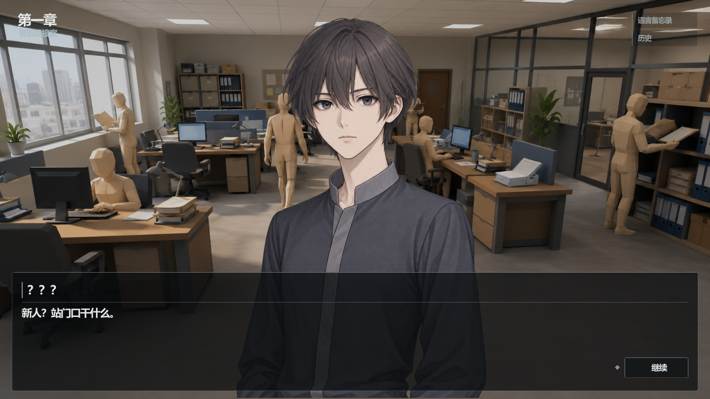
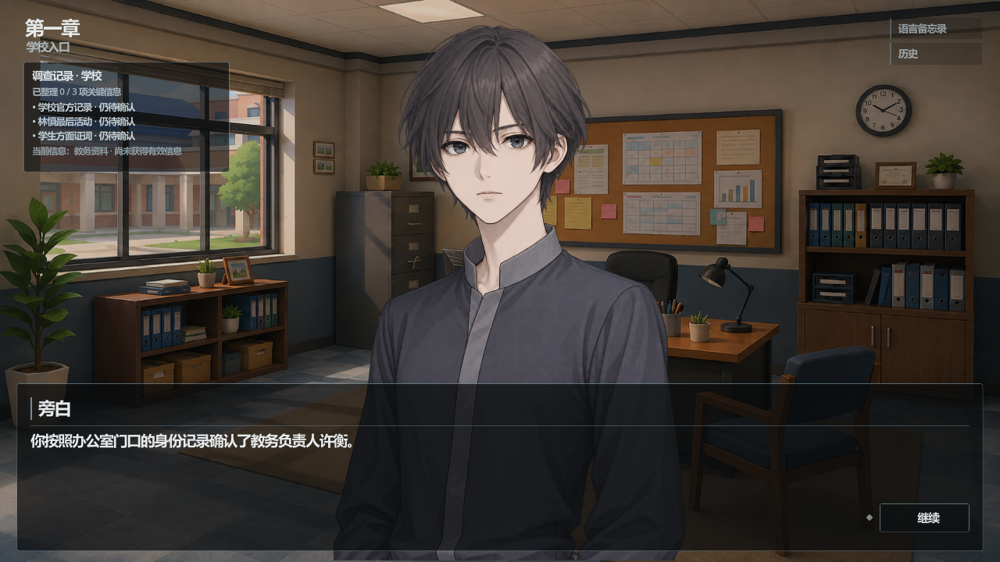

# Anyone · 第一章《最后一节课》

一款围绕语言习惯、身份与人际关系展开的侦探叙事游戏。

在这个所有人外貌完全一致的世界里，看见一个人，并不代表知道他是谁。你是一名刚入职的警察，接手了一位教师失踪的案件。调查中，你需要观察人们怎样说话，以及他们愿意向谁说出真相。

**[下载 Windows 第一章试玩版](https://github.com/jim6642/Anyone-Chapter01/releases/tag/v0.1.0-chapter01)**

这是一个个人实验性作品。目前提供可完整游玩的第一章，后续章节暂无制作计划。欢迎下载体验，也欢迎通过 [Issues](https://github.com/jim6642/Anyone-Chapter01/issues) 留下反馈。

## 内容

- 背景与共享角色立绘构成的视觉小说表现。
- 学校调查、人物访谈与分支选择。
- 两次身份模仿：学习语言习惯，借用人物之间的关系获取信息。
- 自由记录正文的语言备忘录、对白历史、存档和设置。

## 运行

1. 在下载页面的 **Assets** 中选择 `Anyone-Chapter01-v0.1.0-Windows-x64.zip`。
2. 将 ZIP 完整解压到一个文件夹。
3. 双击 `Anyone_Chapter01.exe`。

平台：Windows 10 / 11，64 位。语言：简体中文。游戏包内已包含运行所需资源，无需安装 Godot。

请下载上面的游戏 ZIP；GitHub 自动生成的 `Source code` 压缩包只包含本页面资料，不能运行游戏。

## 操作

- 鼠标点击「继续」推进对白。文字逐字显示时，首次点击显示全文，再次点击推进。
- 点击选项作出选择；选项较多时可以滚动。
- 拖动选择正文中的 2～20 个字，点击「记录」，自行选择人物或世界观归属。
- 右上角打开语言备忘录或历史。
- `Esc` 打开暂停菜单，可保存、读取和调整设置。

备忘录中的匹配高亮只表示与你自己记录的文字相符，不代表当前选项一定正确。

## 画面

## 版本说明与反馈

当前版本为 **v0.1.0-chapter01**，公开试玩预发布版本，不代表完整游戏正式发行。

如遇问题，反馈时请写明所在场景、最后看到的对白或选项，以及复现步骤。有截图会更方便定位。

## 许可与制作工具

使用 Godot Engine。界面与交互音效来自 Kenney 的 CC0 资源包；背景音乐使用 ACE-Step 生成并经过选择与循环处理。详见 [第三方说明](THIRD_PARTY_NOTICES.md)。

本仓库用于展示和提供试玩下载，不包含 Godot 工程源码或完整剧情设计文档。公开下载不代表授予游戏素材、剧情或程序的再发布、改编或商业使用许可；第三方内容按其各自许可处理。
